<div align="center">

# 🐕 Canine Patella Sim

**Video-calibrated physics model of a dog, and what patellar luxation does to its gait**

Undergraduate thesis · CUCG Lab, The Catholic University of Korea · 2026

<table>
<tr><th align="center">한국어</th><th align="center">English</th></tr>
<tr><td>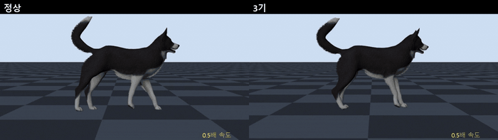</td><td>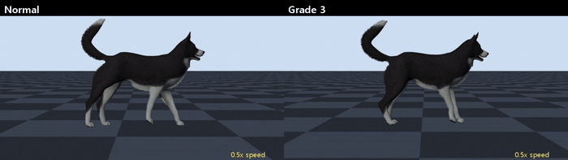</td></tr>
<tr><td align="center"><sub>왼쪽: leo에 맞춘 정상 모델 · 오른쪽: 같은 몸에 3기 무릎 신전 한계를 건 모델 (최종 모델, 0.5배속)</sub></td><td align="center"><sub>Left: healthy model fitted to Leo · Right: same body with a Grade 3 knee-extension limit (final model, half speed)</sub></td></tr>
</table>

[Project page](https://wri0raan.github.io/JURAN/research/gait.html) · [Portfolio](https://wri0raan.github.io/JURAN/) · [Figures and videos for presenting](docs/PRESENTATION.md)

</div>

---

## The question

Small dogs with patellar luxation can't fully straighten the knee, and in the clinic they walk with extra motion at the hip and hock to make up for it.

**Is the knee limit alone enough to produce that compensation?**
This project tests it in physics: build a dog model from video of a real dog, lock its knee to clinically measured limits per grade, re-optimize the gait, and compare the joint angles with clinical measurements.

## Pipeline

<table>
<tr><th align="center">한국어</th><th align="center">English</th></tr>
<tr><td>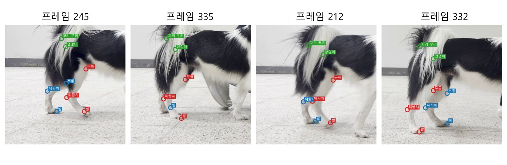</td><td>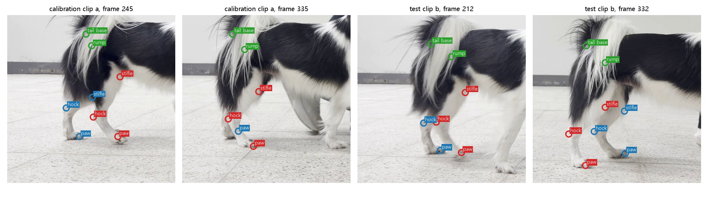</td></tr>
<tr><td align="center"><sub>직접 표시한 점의 예: 보정용 구간 a, 시험용 구간 b</sub></td><td align="center"><sub>Hand-marked points: calibration clip a, test clip b</sub></td></tr>
</table>

<table>
<tr><th align="center">한국어</th><th align="center">English</th></tr>
<tr><td>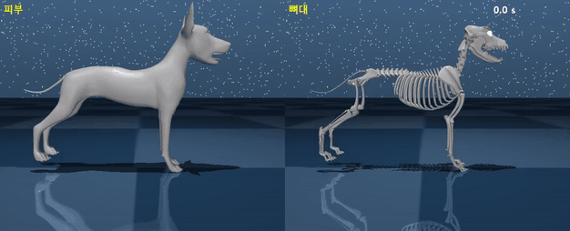</td><td>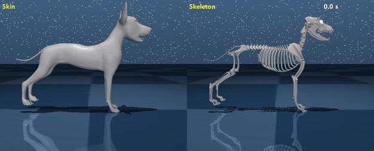</td></tr>
<tr><td align="center"><sub>피부와 뼈대 렌더링(최종 모델)</sub></td><td align="center"><sub>Skin and skeleton render (final model)</sub></td></tr>
</table>

**A. Video → healthy model**

1. **Film** — Leo (7 kg mixed breed), side view, 4K 120 fps; walking passes picked from contact sheets
2. **Keypoints** — SuperAnimal-Quadruped (DeepLabCut) → stride period, fore/hind order, swing height
3. **Body** — measured segment lengths + a standing side photo → per-segment scale of the MuJoCo / dm_control Dog
4. **Healthy gait** — CMA-ES, adding cost terms one stage at a time; validated on video metrics that were *not* used in the fit
   → simulated stride period **0.43 s** vs. Leo **0.41 s**

**B. Healthy model → clinical grades**

5. **Inject the grade** — knee-extension limit per grade as a joint limit (mechanical / functional)
6. **Re-optimize under three hypotheses** — H1 minimize energy · H2 keep healthy joint excursions · H3 avoid load (pain); plus a one-sided limit; 3 seeds each
7. **Compare** — knee, hock and hip angles against clinical measurements (Chayatup et al., *Vet J* 313, 2025)
8. **Render** — skin + skeleton comparison videos per grade

<table>
<tr><th align="center">한국어</th><th align="center">English</th></tr>
<tr><td>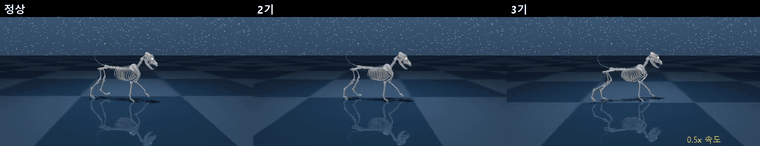</td><td>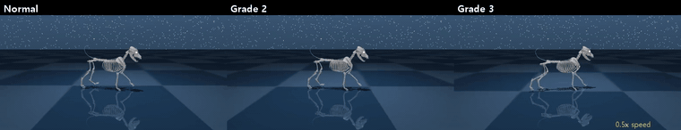</td></tr>
<tr><td align="center"><sub>뼈대로 본 등급별 걸음: 정상 · 2기 · 3기 (최종 모델)</sub></td><td align="center"><sub>Skeleton gait across grades: Normal · Grade 2 · Grade 3 (final model)</sub></td></tr>
</table>

## Results

<table>
<tr><th align="center">한국어</th><th align="center">English</th></tr>
<tr><td>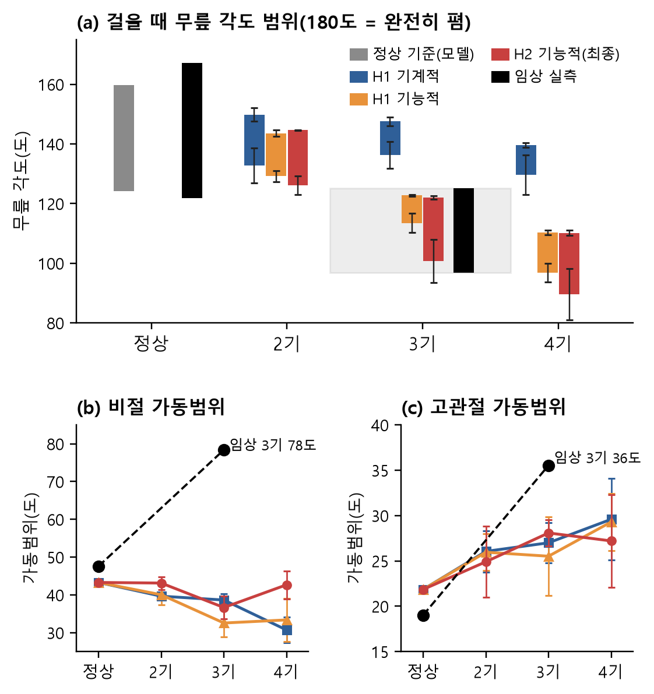</td><td>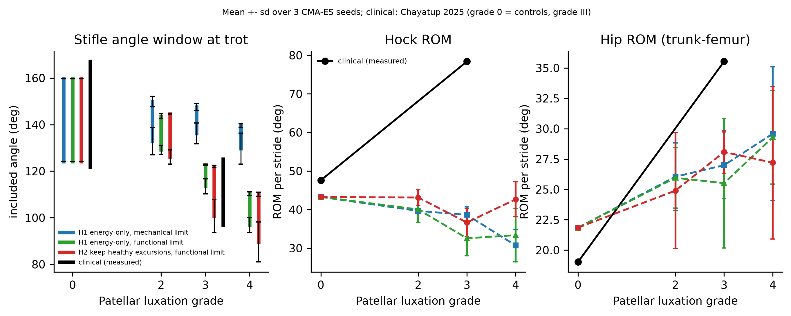</td></tr>
<tr><td align="center"><sub>등급별 모델과 임상 실측의 관절 각도(시드 3개 평균, 검은색 = 임상 실측)</sub></td><td align="center"><sub>Simulated vs. clinical joint angles by grade (mean of 3 seeds; black = clinical)</sub></td></tr>
</table>

- **Knee** — the Grade III knee angle lands in the clinical range **only under H2** (keep healthy excursions).
- **Hock** — clinical dogs increase hock motion with grade; **no hypothesis and no model variant reproduced it.**
- **Takeaway** — the knee limit alone does not explain compensatory gait. Something beyond the joint constraint (behavior, muscle, pain) is needed.

A mismatch with clinical data is treated as a result, not a failure.

### Final model and knee-status judge

The thesis then uses the model the other way round: **compare a walking video of the dog with the physics-model dog and judge the knee status.**

- **Final model (fitR3)** — refit with clinical joint-window targets; speed (0.80 m/s) and stride frequency (2.2 Hz) come from video only. Its knee range of motion (38°) and speed (0.69 m/s) are still smaller than the video (about 53–56°, 0.8 m/s); this is kept as a limitation.
- **Model prediction** — mean knee angle: normal 125.4°, Grade 2 −6.3°, Grade 3 −21.9° (H2, functional limit).
- **Judge** — the knee angle measured in the video (same landmark definition as the model; the rump point comes from a radiograph) is compared with the model's per-grade prediction.
- **Result on 5 test clips** — model only: per-class hit rate normal 0.40 / Grade 2 0.60 / Grade 3 1.00; **mild (normal–Grade 2) vs. severe (Grade ≥ 3): 0.87**, 1.00 when healthy baseline clips of the same dog are added.
- **Limits** — normal and Grade 2 cannot be separated; severe and Grade 2 cases were tested only semi-synthetically (the model's change added to real healthy video); one normal clip (IMG_7725) was called abnormal by the model-only judge and normal with the baseline. Grades 1, 2 and 4 are interpolated, not measured.

<table>
<tr><th align="center">한국어</th><th align="center">English</th></tr>
<tr><td>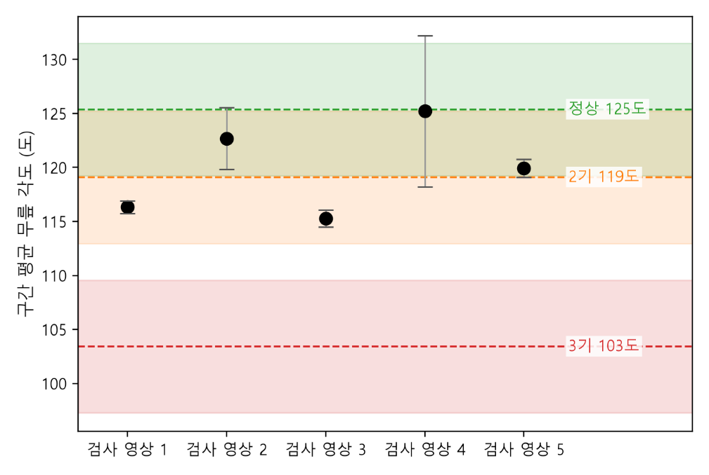</td><td>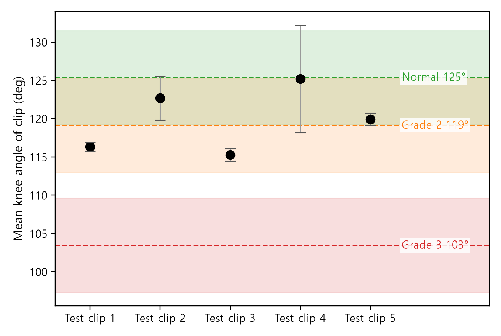</td></tr>
<tr><td align="center"><sub>판정 검사 영상 5구간의 평균 무릎 각도(점)와 모델의 정상, 2기, 3기 예측(점선)</sub></td><td align="center"><sub>Mean knee angle of the 5 test clips (dots) and the model's predictions for normal, Grade 2 and Grade 3 (dashed)</sub></td></tr>
</table>

## Figures and videos for presenting

Everything needed to present from another PC is in the repository: clone it and open the files, or open the links on GitHub when online (about 180 MB).

```bash
git clone https://github.com/wri0raan/canine-patella-sim
```

| What | Where |
|---|---|
| **Gallery with captions and a suggested order** | **[docs/PRESENTATION.md](docs/PRESENTATION.md)** |
| Simulation videos (54, all playable) | `results/videos/` |
| Final thesis figures 1–21 | `results/figures/thesis_final/` |
| Earlier thesis figures | `results/figures/thesis/` |
| Other result figures | `results/figures/` |
| Result tables | `results/*.csv`, `results/*.json` |

Key videos: [final model, Border Collie skin](results/videos/BC_final_model_grades.mp4) · [same gait, white skin](results/videos/MODEL_grades_fitR3.mp4) · [skeleton by grade](results/videos/Q_grades_H2_skeleton.mp4) · [judge on IMG_7725](results/videos/JUDGE_IMG7725.mp4)

The Border Collie skin is a visualisation of the same gait on another breed's appearance, not Leo's look.

## Next

Turn this into a tool that builds a per-dog physics model from video:
a second dog to test generality → automate the fitting → add a muscle layer and a learned controller → validate on videos of real patients.

## Repository layout

```
sim/        MuJoCo / dm_control dog: scaling, gait, impairment, rollout
configs/    gait, impairment (patella.yaml) and model (leo.yaml) settings — no magic numbers in code
scripts/    pose extraction, optimization runners (run_*.sh), rendering
analysis/   metrics shared by sim and video, figures, clinical comparison
docs/       PIPELINE.md (step-by-step reproduction), PRESENTATION.md (figures and videos), research notes
results/    figures/ (incl. thesis/), videos/, result tables (csv, json)
```

## Reproduce

Three environments: `.venv` (simulation: MuJoCo, dm_control, CMA-ES), `.venv_dlc` (pose estimation: DeepLabCut, PyTorch, GPU), `.venv_bpy` (Blender rendering).
Every stage, its command and its outputs are listed in **[docs/PIPELINE.md](docs/PIPELINE.md)**.

```bash
sh scripts/run_leo_chain4.sh        # healthy gait, staged
python scripts/eval_leo_gait.py leoH3   # independent check against video
sh scripts/run_leo_sweeps.sh        # grades × hypotheses × seeds
python analysis/final_results.py --leo --prefix s   # tables and figures
```

## Data

Leo's raw videos and the original radiograph files are not included; a few figures made from Leo's own radiographs (landmark offsets, bone-name diagrams) are. The thesis text is not included. Reference videos of other dogs were used for qualitative comparison only and are not redistributed.

Because the raw data and earlier run folders are not in the repository, the tracking and judging stages and the grade sweeps cannot be rerun from a fresh clone; the figures, videos, tables and code are provided for inspection and presentation.
Clinical values come from Chayatup, Wangdee & Soontornvipart, *The Veterinary Journal* 313 (2025) 106369 — only Grade 0 and Grade III are measured there; other grades are interpolated and labelled as such.

---

<div align="center">
<sub>Juran Kim · <a href="https://wri0raan.github.io/JURAN/">wri0raan.github.io/JURAN</a> · with Leo 🐾</sub>
</div>
