# 발표용 그림과 영상 (Figures and videos for presenting)

영상과 그림은 모두 이 저장소 안에 있습니다. 인터넷이 되면 아래 링크를 눌러 GitHub 페이지에서 바로 재생됩니다. 인터넷이 없는 곳에서는 저장소를 내려받아(약 200 MB) 폴더에서 영상 파일을 열면 됩니다.

```bash
git clone https://github.com/wri0raan/canine-patella-sim
```

영상은 `results/videos/`, 그림은 `results/figures/`(논문 그림은 `results/figures/thesis/`)에 있습니다. 모든 영상은 시뮬레이션 자료이며, 정량 값은 시뮬레이션과 영상 추적에서 계산한 것입니다. 보더콜리 피부는 다른 견종의 외형에 같은 걸음을 입힌 시각화입니다.

## 1. 추천 발표 순서 (영상)

| 순서 | 영상 | 내용 |
|---|---|---|
| 1 | [BC_final_model_grades.mp4](../results/videos/BC_final_model_grades.mp4) | 최종 모델(fitR3) 정상, 2기, 3기. 보더콜리 피부, 원본 털색, 0.5배속 |
| 2 | [BC_final_model_grades_leocoat.mp4](../results/videos/BC_final_model_grades_leocoat.mp4) | 같은 걸음, 레오 털색과 접힌 귀 |
| 3 | [MODEL_grades_fitR3.mp4](../results/videos/MODEL_grades_fitR3.mp4) | 같은 걸음, 기본 흰 피부 |
| 4 | [Q_grades_H2_skeleton.mp4](../results/videos/Q_grades_H2_skeleton.mp4) | 뼈대로 본 등급별 걸음(H2 기능적) |
| 5 | [JUDGE_IMG7725.mp4](../results/videos/JUDGE_IMG7725.mp4) | 판정 검사 영상 5(IMG_7725)의 추적과 판정(4배 느리게) |
| 6 | [LEO_analysis_A.mp4](../results/videos/LEO_analysis_A.mp4), [LEO_analysis_B.mp4](../results/videos/LEO_analysis_B.mp4) | 레오 통과 구간의 분석 오버레이 |

## 2. 모델과 설정 비교

| 영상 | 내용 |
|---|---|
| [A_grades_H2.mp4](../results/videos/A_grades_H2.mp4) | 정상, 2기, 3기, 4기(H2 기능적) |
| [B_hypotheses_G3.mp4](../results/videos/B_hypotheses_G3.mp4) | 3기에서 가설별 비교(정상, H1 기계적, H1 기능적, H2, H3, 편측) |
| [R_grades_H1_mechanical.mp4](../results/videos/R_grades_H1_mechanical.mp4), [S_grades_H1_functional.mp4](../results/videos/S_grades_H1_functional.mp4), [T_grades_H3_pain.mp4](../results/videos/T_grades_H3_pain.mp4) | 설정별 등급 비교(H1 기계적, H1 기능적, H3 통증 회피) |
| [U_grade3_hypotheses.mp4](../results/videos/U_grade3_hypotheses.mp4) | 3기에서 가설별 비교(뼈대) |
| [V_grade3_H2_skin_skeleton.mp4](../results/videos/V_grade3_H2_skin_skeleton.mp4) | 3기 H2 걸음, 피부와 뼈대 |
| [W_speed_matched_H2.mp4](../results/videos/W_speed_matched_H2.mp4) | 속도를 맞춘 정상 2종과 H2 등급 |
| [X_unilateral_LH.mp4](../results/videos/X_unilateral_LH.mp4) | 편측(왼뒷다리만) 손상 |
| [O_leoH3_skin_skeleton.mp4](../results/videos/O_leoH3_skin_skeleton.mp4), [P_normal_vs_half_speed.mp4](../results/videos/P_normal_vs_half_speed.mp4) | 정상 기준 보행, 현재 속도와 절반 속도 비교 |
| [TROT_attempt_trotS4.mp4](../results/videos/TROT_attempt_trotS4.mp4) | 속보 합성 시도(1.06 m/s에서 안정, 레오 속보 2 m/s 이상은 실패) |

## 3. 보더콜리 피부 변형

[BC3](../results/videos/BC3_ears_up_tail_up_healthy_vs_grade3.mp4) 정상 대 3기 · [S1](../results/videos/S1_skin_grades_H2.mp4) 등급별 · [S2](../results/videos/S2_skin_grade3_hypotheses.mp4) 가설별 · [S3](../results/videos/S3_skin_unilateral_LH.mp4) 편측 · [Z1](../results/videos/Z1_bordercollie_speed_matched.mp4) 속도 맞춤 · [BC1](../results/videos/BC1_speed_matched_folded_ears.mp4), [BC2](../results/videos/BC2_healthy_vs_grade3_folded_ears.mp4) 접힌 귀 · [BCL1](../results/videos/BCL1_leo_coat_speed_matched.mp4), [BCL2](../results/videos/BCL2_leo_coat_healthy_vs_grade3.mp4) 레오 털색

## 4. 근력과 지방 실험

[LAY_muscle.mp4](../results/videos/LAY_muscle.mp4) 근력 1.0, 0.8, 0.6, 0.5 · [LAY_muscle_strong.mp4](../results/videos/LAY_muscle_strong.mp4) 근력 0.5, 1.0, 1.2, 1.4 · [LAY_fat.mp4](../results/videos/LAY_fat.mp4) 기준, 지방 +20%, +40%, 근력 0.6과 지방 조합(빨간 캡슐과 노란 껍질은 모식적 시각화)

## 5. 레오 영상 분석 오버레이

[LEO3_analysis_n1](../results/videos/LEO3_analysis_n1.mp4) · [n2](../results/videos/LEO3_analysis_n2.mp4) · [n3](../results/videos/LEO3_analysis_n3.mp4) · [n4](../results/videos/LEO3_analysis_n4.mp4) · [n5](../results/videos/LEO3_analysis_n5.mp4) (추적선과 판정을 입힌 새 영상 5개) · [L1_leo_analysis_overlay](../results/videos/L1_leo_analysis_overlay.mp4)

## 6. 논문 최종본(v30) 그림 1~21

논문 최종본에 실린 그림을 번호 순서대로 모았습니다(`results/figures/thesis_final/`). 캡션은 첫 문장만 적었고, 전체 설명은 논문을 보시면 됩니다. 그림 10은 방사선 사진이 들어 있습니다.


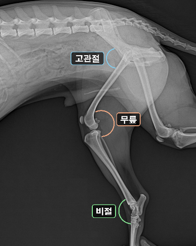


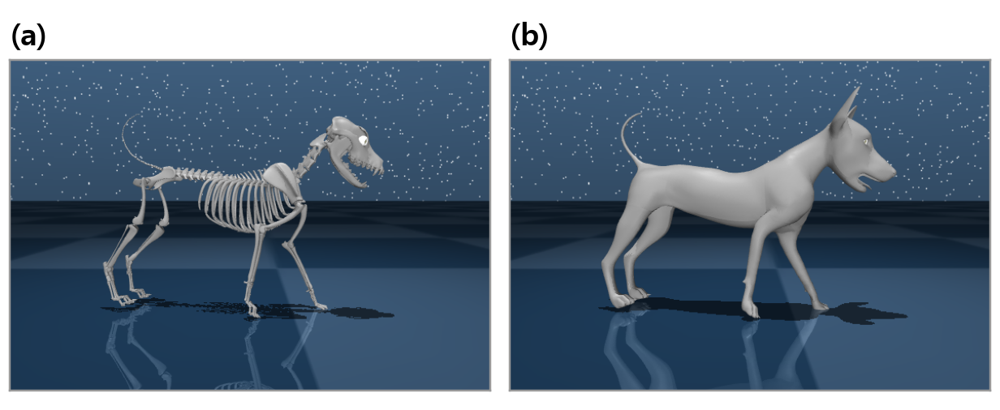
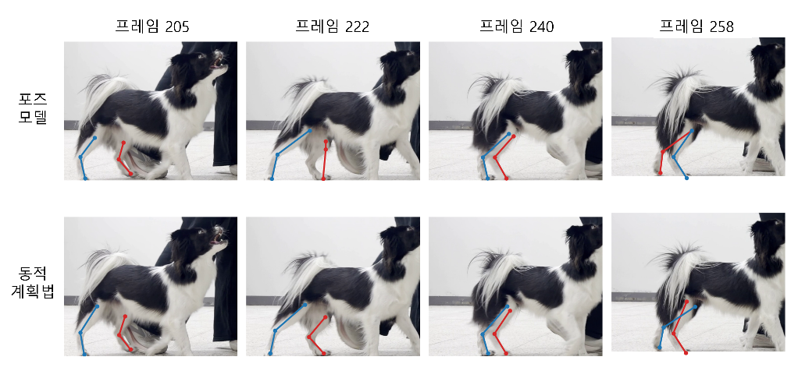
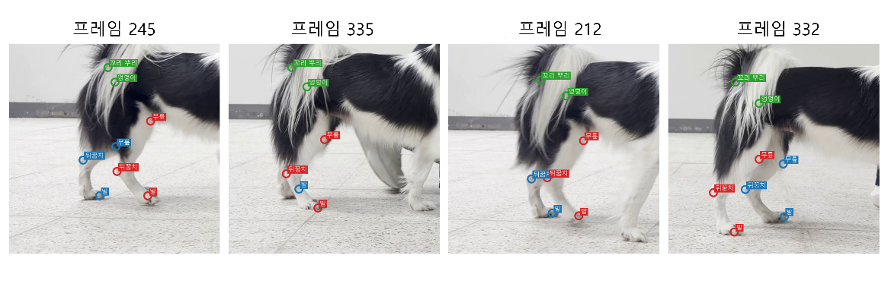
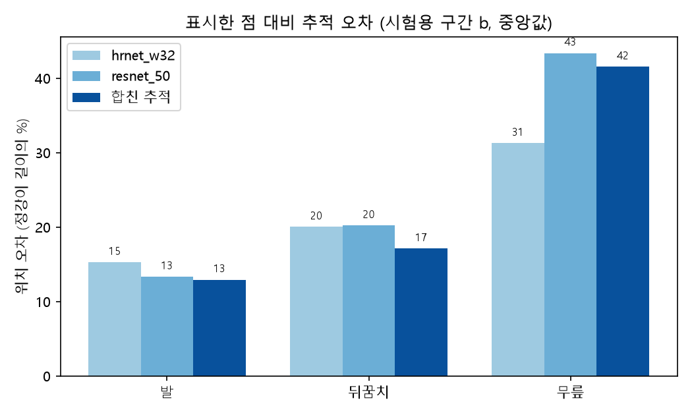
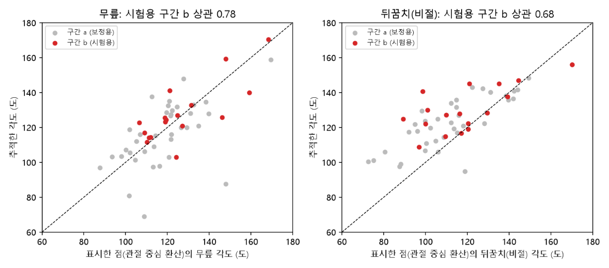
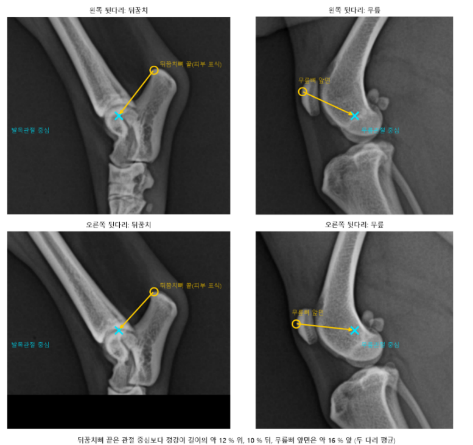
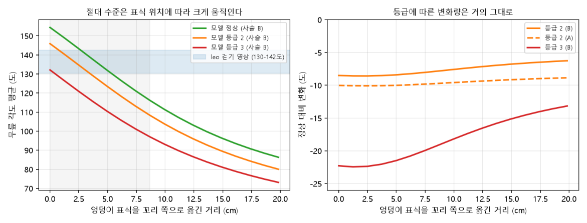
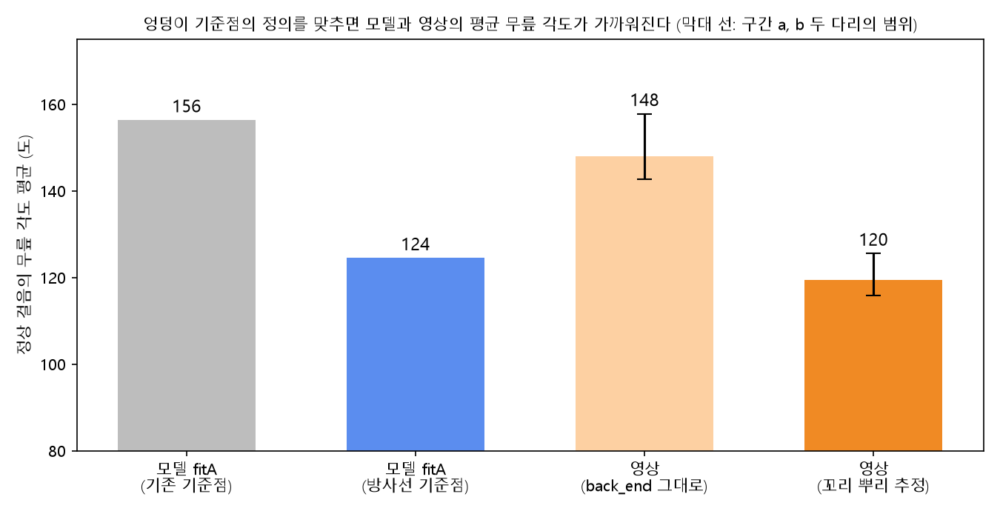

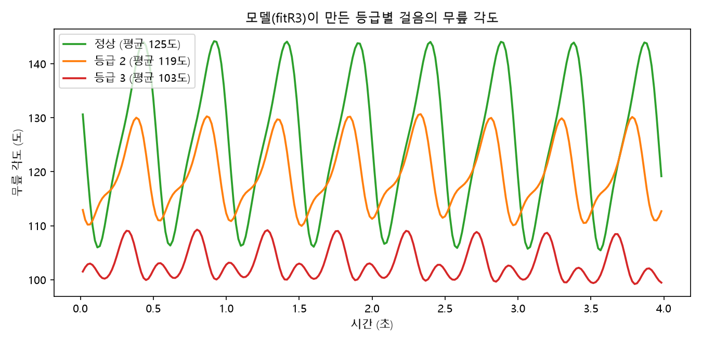

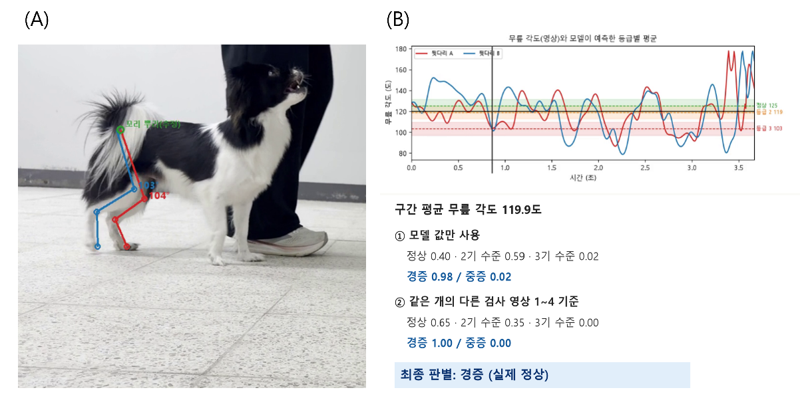
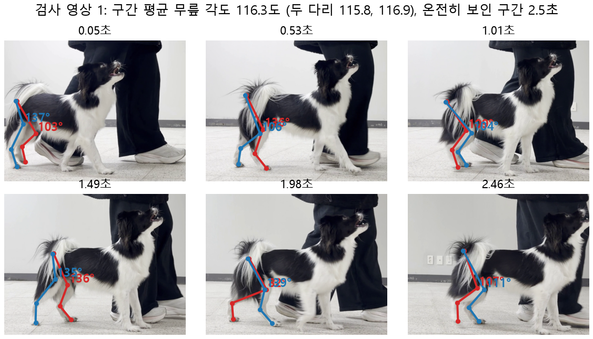
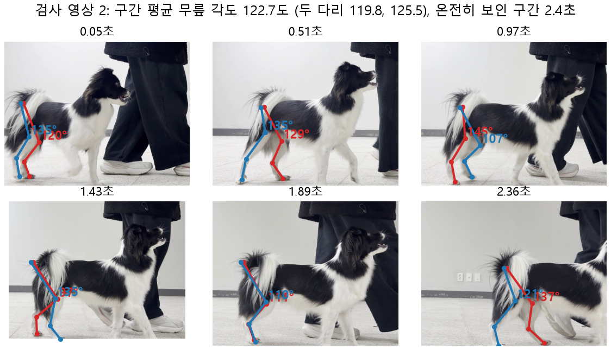
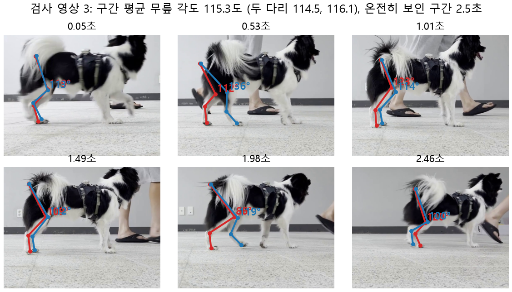
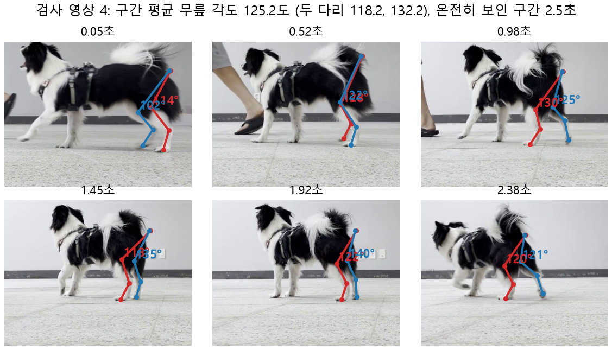
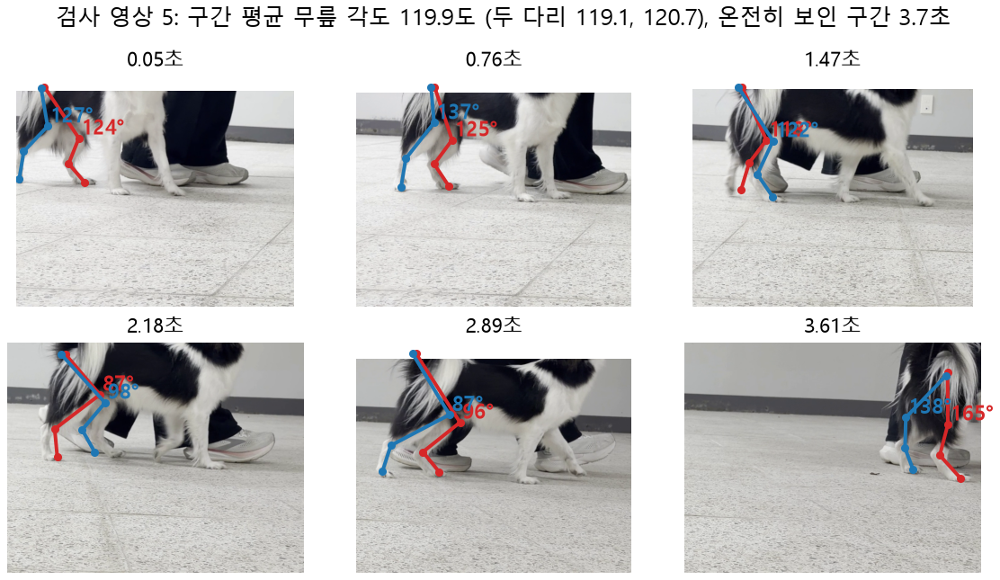

## 7. 그 밖의 결과 그림

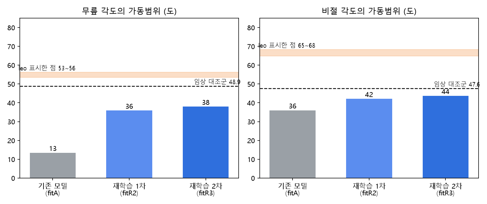
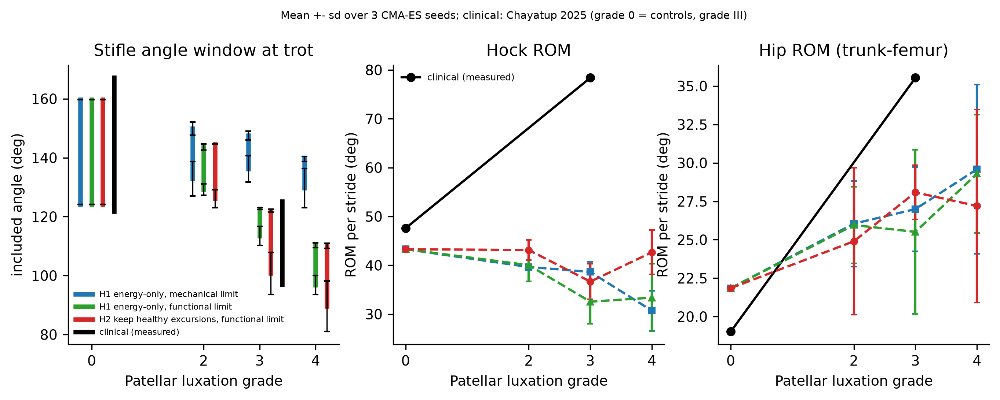

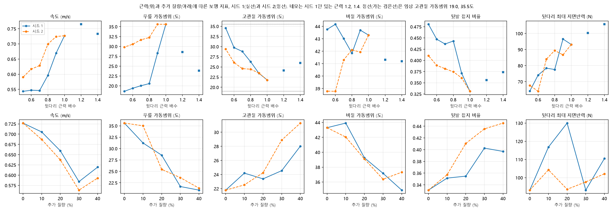


## 8. 한계 (발표 때 말할 점)

- 한 마리의 개와 가상의 비정상 사례에 근거한 가능성의 확인이며 진단을 대신하지 않습니다.
- 임상 실측은 정상과 3기뿐이고 1, 2, 4기는 추정 입력입니다.
- 모델의 무릎 움직임 폭(38도)은 영상(약 53~56도)보다 작고, 속도도 0.69 m/s로 목표 0.80 m/s에 못 미쳤습니다.
- 정상과 2기는 가르지 못하고, 경증(정상~2기) 대 중증(3기 이상)만 구분합니다(0.87, 정상 기준 영상을 함께 쓰면 1.00).
- 중증은 정상 영상에 모델의 변화량을 더한 가상 사례로 시험했습니다.
- 속도, 걸음 주기, 보폭만으로는 무릎 상태를 식별할 수 없었고, 근력과 체중도 식별되지 않았습니다.
- 뼈 이름 도식은 눈으로 읽은 모식도라 수의사 확인을 권장합니다.
- 원본 촬영 영상과 방사선 원본 파일은 공개 저장소에 올리지 않았습니다.
